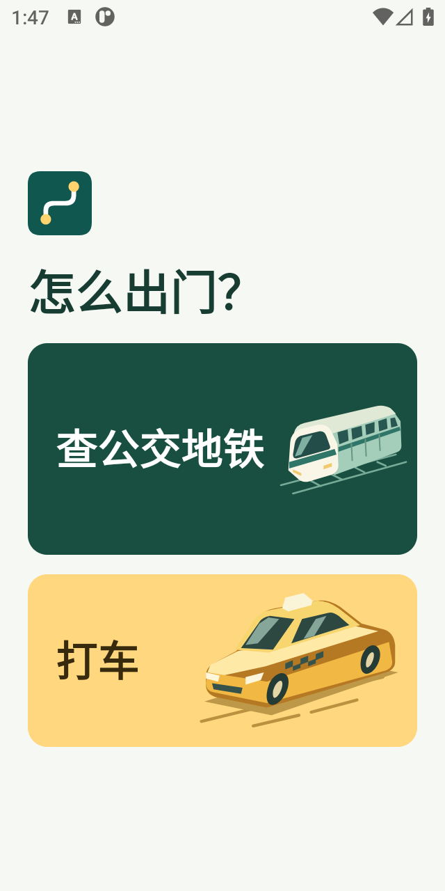
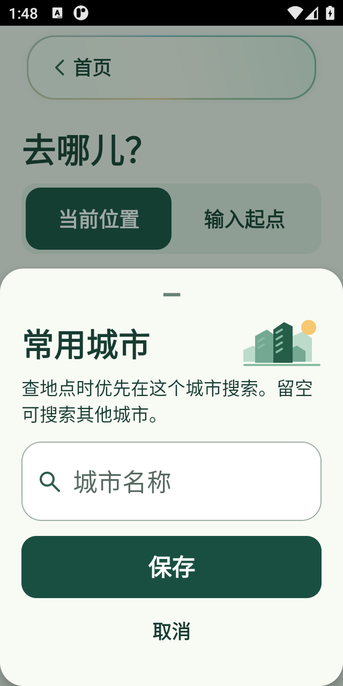

# 出门

一个适合小米等安卓手机的高德地图桌面入口。打开后可以输入目的地查公交地铁，也可以直接进入高德打车页。

## 安装

在装有高德地图的 Android 8 或更高版本手机上，下载并安装 [最新版 Chumen.apk](https://github.com/suyh1/open-clear/releases/latest/download/Chumen.apk)。后续版本可以覆盖安装。

用小米手机的「扫一扫」扫描下方二维码，即可下载最新正式版。以后更新也扫这个码。


## 界面预览

  

## 查公交地铁

起点默认是「当前位置」。也可以点「输入起点」，填写出发的车站、路口或门牌地址。起点和目的地都有地点联想，点「选用」可直接使用，也可以点地名展开详情，核对地址后选「从这里出发」或「去这里」。两处都可以直接输入完整名称再点「查看路线」。

如果起点坐标已确定，多个候选目的地下会有「比较距起点的距离」。在图上左右滑动，可以查看各地点距起点的直线距离。乘车路线和用时以高德路线页为准。

点顶部「设置常用城市」，在底部面板输入城市并保存。清空后保存即可恢复跨城市搜索。拖动面板顶部的横线可以展开或收起，也可以直接点横线。

地点联想会将已输入的文字发送到 Esri。允许定位或已选定手填起点时，目的地查询可以使用保留两位小数的起点经纬度来优先查找附近地点。「当前位置」模式会把足够准确的新位置交给高德；只有大致位置或暂时定位失败时，由高德获取当前位置。手填模式使用选定地点的坐标。退出公交查询页或切到后台后，小工具停止请求定位。

## 构建与发布

向 `main` 推送提交或提交拉取请求时，GitHub Actions 会编译 APK，并将临时签名的测试包保存在该次运行的 Artifacts 中。手机日常使用请安装 Releases 中的正式包。

要发布新版本，在目标提交上创建递增的版本标签并推送。例如：

```sh
git tag v1.0.1
git push origin v1.0.1
```

GitHub Actions 会从标签提取版本号，使用仓库 Secrets 中的签名密钥构建 APK，核对签名证书后自动创建 Release 并上传安装包。签名配置使用 `CHUMEN_KEYSTORE_BASE64` 和 `CHUMEN_SIGN_PASS`。
