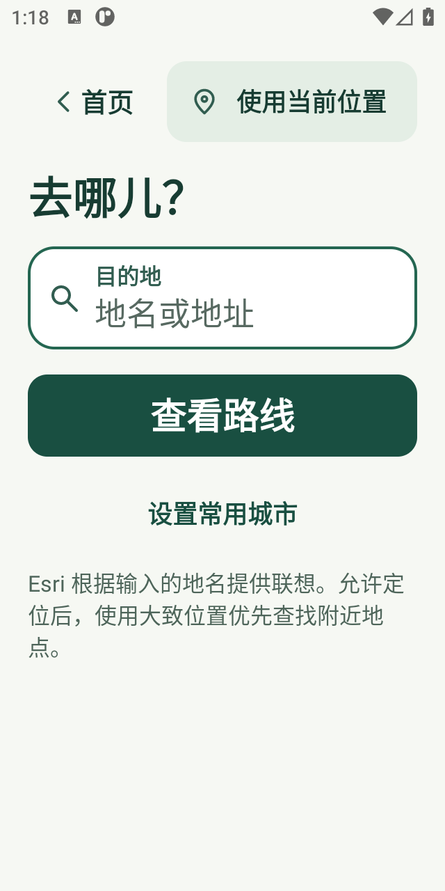

# 出门

一个适合小米等安卓手机的高德地图桌面入口。打开后可以输入目的地查公交地铁，也可以直接进入高德打车页。

## 安装

在装有高德地图的 Android 8 或更高版本手机上，下载并安装 [最新版 Chumen.apk](https://github.com/suyh1/open-clear/releases/latest/download/Chumen.apk)。后续版本可以覆盖安装。

用小米手机的「扫一扫」扫描下方二维码，即可下载最新正式版。以后更新也扫这个码。


## 界面预览

 

## 查公交地铁

第一次可以点「使用当前位置」，在系统提示中允许使用期间访问位置。输入几个字，点选联想列表里的地点，就会打开高德的公交路线。也可以输入完整地址，再点「查看路线」。

地点联想会将已输入的文字发送到 Esri。允许定位时，查询会带上取整到小数点后两位的经纬度，用于优先查找附近地点。获取到足够准确的新位置时，会将它作为路线起点交给高德；仅授权大致位置或暂时定位失败时，起点由高德获取。退出公交查询页或切到后台后，小工具停止请求定位。

## 构建与发布

向 `main` 推送提交或提交拉取请求时，GitHub Actions 会编译 APK，并将临时签名的测试包保存在该次运行的 Artifacts 中。手机日常使用请安装 Releases 中的正式包。

要发布新版本，在目标提交上创建递增的版本标签并推送。例如：

```sh
git tag v1.0.1
git push origin v1.0.1
```

GitHub Actions 会从标签提取版本号，使用仓库 Secrets 中的签名密钥构建 APK，核对签名证书后自动创建 Release 并上传安装包。签名配置使用 `CHUMEN_KEYSTORE_BASE64` 和 `CHUMEN_SIGN_PASS`。
